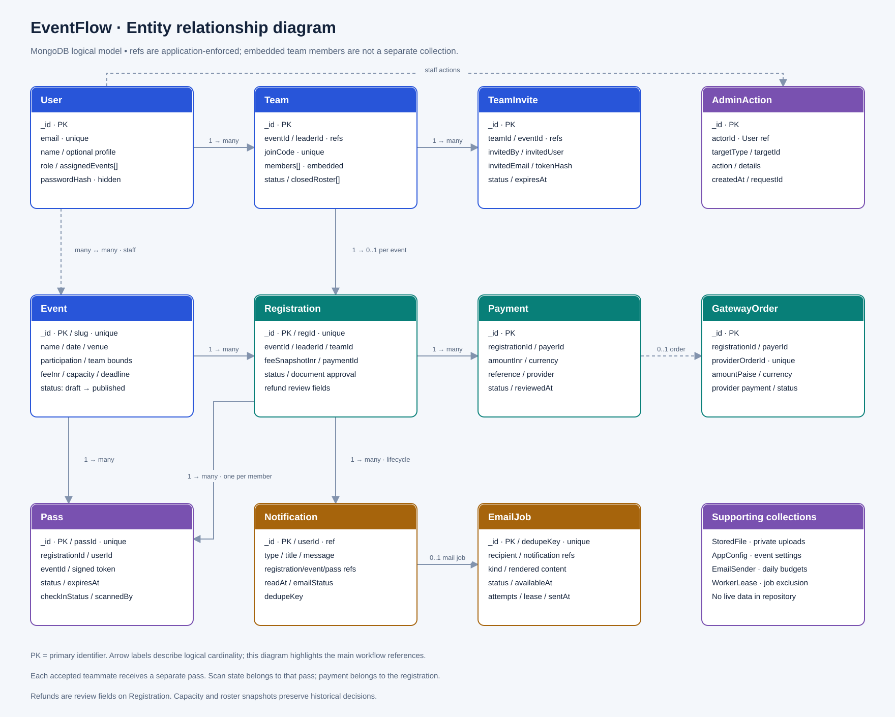

# EventFlow · Event management template

A reusable starting point for running an event from the first registration to
the last check-in. Participants discover events, form teams, complete payment,
receive their own entry passes, and arrive with a QR that authorized staff can
scan. Organizers manage the same records instead of reconciling separate forms.

This repository ships with generic branding and fictional sample events. It
contains no live participant records, personal photos, payment QR images,
merchant credentials, private email accounts, or historical Git data.


## How it works

**For a participant:** create an account with a regular email address, browse an
event, then register alone or form a team. A leader can invite someone by email
or share a team code. Invitations require the recipient to accept; receiving an
email does not add them automatically. Once the roster meets the event's rules,
the leader completes registration and payment. Each accepted teammate receives
a separate personal pass when all required approvals are complete.

**For an organizer:** an event manager sees only assigned events. Participant
lists can be grouped by team, expanded to inspect individual members, filtered
by registration/payment/attendance state, and exported. Registration can close
manually or according to its deadline/capacity. The scanner validates the pass,
the event and the staff member's access before recording the first check-in.

**For an administrator:** manage events and staff assignments, review manual
payments or required documents, review withdrawals/refunds, and inspect email
queue status. Super administrators can manage privileged roles. There are no
pre-created staff accounts or published passwords: the operator signs up first
and explicitly bootstraps the initial administrator.

## What is included

- Email/password accounts, password reset and optional Google sign-in.
- Solo/team events, invitations, team codes and registration availability.
- Razorpay hosted checkout with server-created orders, signature checks,
  captured-payment verification and idempotent signed webhooks.
- Optional manual transfer proof and document review.
- Individual signed QR passes, event-scoped scanner and attendance tracking.
- Role-scoped event operations, participant filters and CSV exports.
- Withdrawal/refund review with notifications and recorded transfer evidence.
- Professional HTML + plain-text email for account and event workflow updates,
  backed by a durable queue, retries and an independently scheduled worker.
- Original generic artwork, responsive participant/staff screens and editable
  architecture diagrams.

Specialized external-game integrations and event-specific institutional
policies are deliberately outside this template. Add your own rules and
branding without depending on another organization's database or accounts.

## Run locally

Use Node.js **22.12 or later**, npm and a MongoDB **replica set**. Transactions
require a replica set; a standalone MongoDB process is insufficient. MongoDB
Atlas or a local single-node replica set both work.

```bash
git clone https://github.com/Ixotic27/event-management-template.git
cd event-management-template
npm run install:all
```

Copy `backend/.env.example` to `backend/.env` and `frontend/.env.example` to
`frontend/.env`. Set your own database URL and strong signing secrets. Leave
email and payment credentials empty until you configure your own services.
The frontend never needs database credentials or gateway secrets.

Run these in two terminals:

```bash
# Terminal 1: API
npm run dev:api

# Terminal 2: web application
npm run dev:web
```

Open the frontend URL printed by the development server. Its local API proxy
must match the API port configured in the environment files.

Optional sample events are created only when `ALLOW_SAMPLE_SEED=true` in a
development environment:

```bash
npm run seed --prefix backend
```

Sign up through the UI. To promote your own existing account, temporarily set
`BOOTSTRAP_ADMIN_EMAIL` in the backend environment and run:

```bash
npm run bootstrap:admin --prefix backend
```

Remove that variable afterwards. This command does not invent a password or
send credentials by email. Use the administration screens to assign staff and
specific events.

## Connect your services

| Setup | Guide |
| --- | --- |
| Razorpay test keys, capture settings, verification and webhooks | [Payment setup](docs/payments.md) |
| SMTP sender, domain authentication, providers and worker delivery | [Email setup](docs/email-setup.md) |
| Professional workflow message examples | [Email previews](docs/email-previews/README.md) |
| Hosting, signing secrets, uploads, origins and operator controls | [Deployment guide](docs/deployment.md) |
| Screen-by-screen journey and role permissions | [Workflow guide](docs/workflows.md) |
| ER diagram and high-level system design | [Architecture diagrams](docs/diagrams/README.md) |
| Meaningful verification and remaining limits | [Test record](docs/testing/README.md) |

Email delivery is disabled until configured. Payment checkout is unavailable
until valid keys for the selected mode are provided. A successful browser
callback alone cannot confirm payment. Refund review records the operator's
actual transfer; the application does not automatically send refunds.

## Architecture at a glance

React provides the participant and staff interface. An Express API owns access
control, registration rules and payment verification. MongoDB stores the
business state and email outbox transactionally. Request-time delivery attempts
run after commit; a scheduled worker retries queued messages. Razorpay handles
the hosted payment interface, and your configured SMTP provider delivers mail.




Both diagrams are available as editable `.drawio` files and rendered SVG/PNG.
They describe the actual logical MongoDB model; references are enforced by
application rules rather than SQL foreign keys.

## Development and verification

```bash
npm test --prefix backend
npm test --prefix frontend -- --runInBand
npm run build
npm run test:privacy
```

Read [SECURITY.md](SECURITY.md) before using this for a public event. Automated
tests use disposable databases and fake mail/payment providers; real merchant
settlement and inbox delivery still require testing with your own credentials.
Contributions are welcome under the [ISC license](LICENSE).
