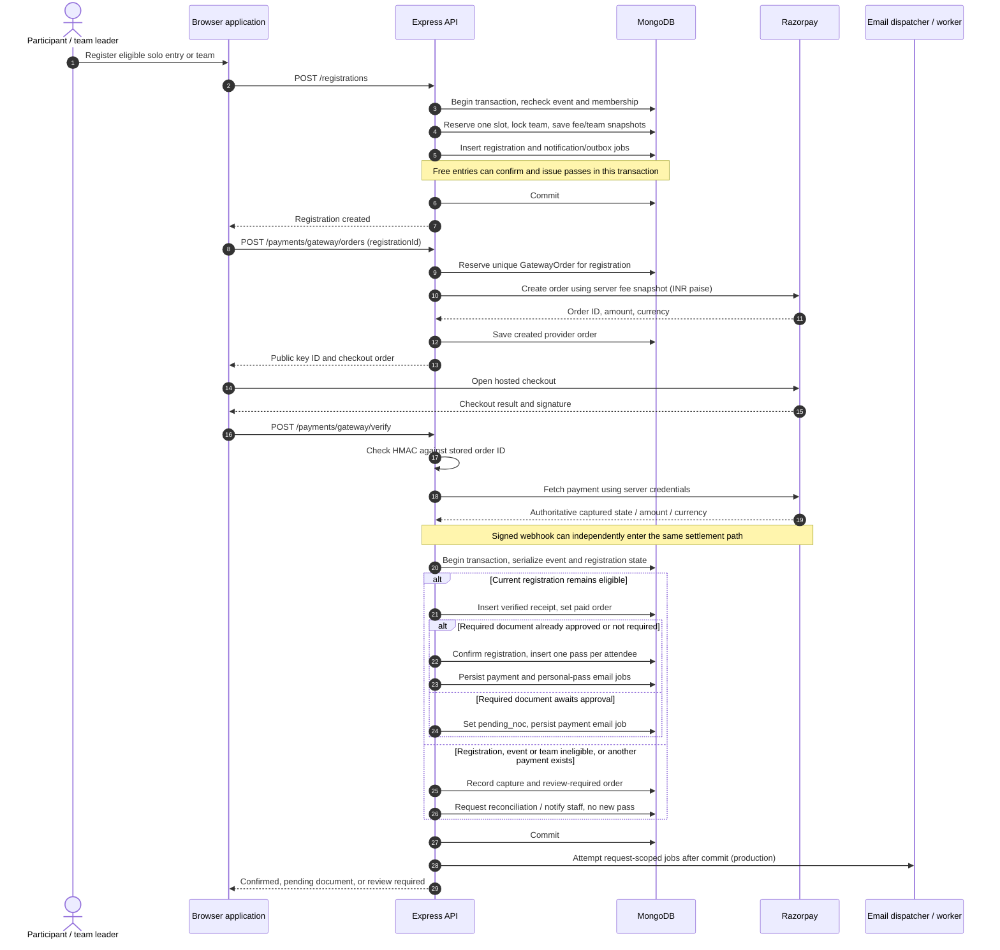
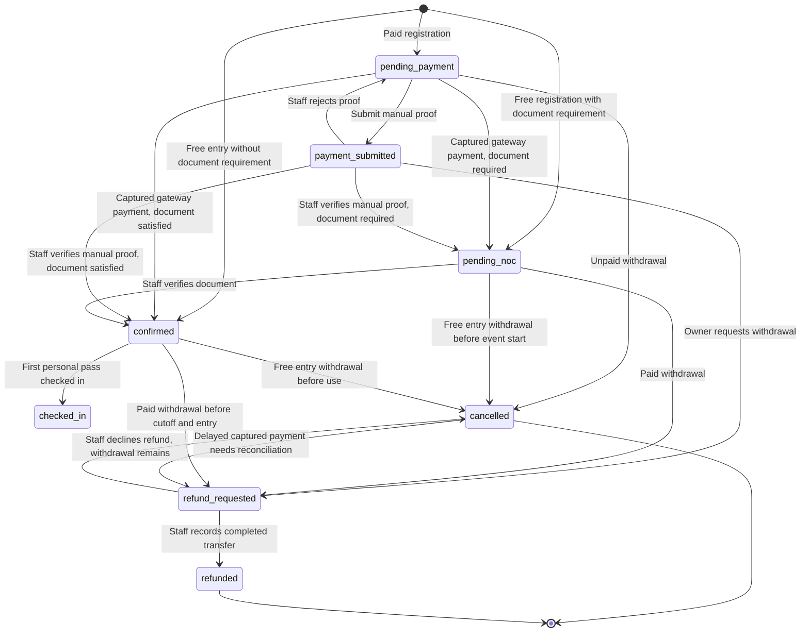
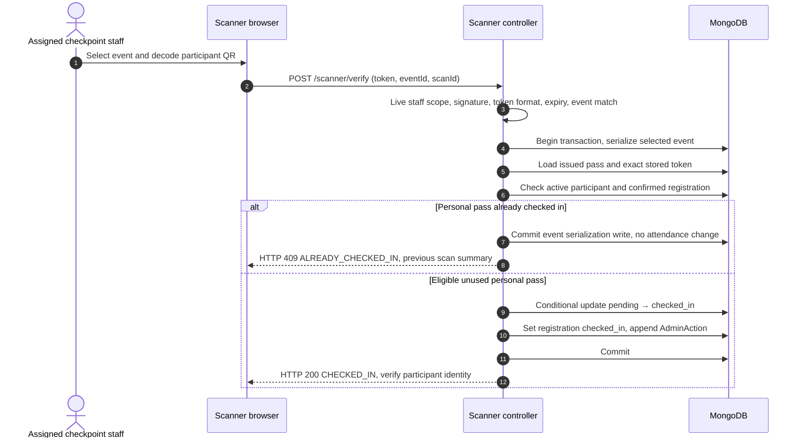
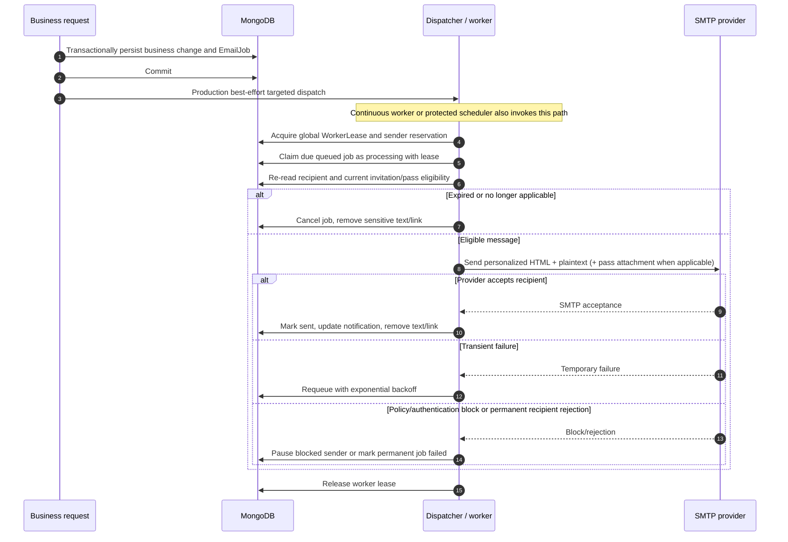

# Muster — low-level design

This document describes the reusable API's implemented request paths and consistency rules. The included React application is a reference client; an adopter can implement the same contracts in another frontend. Paths below are relative to **`/api/v1`** unless explicitly stated. Identifiers such as `eventId` are MongoDB ObjectId strings; `regId` and `passId` are human-facing generated references.

## 1. Request pipeline and contracts

The [Express application](../../backend/src/app.js) applies security headers, configured CORS, request IDs, rate limits and cookie parsing. The Razorpay webhook is mounted with a raw JSON-body parser **before** the normal JSON parser. Route validation uses Joi; authentication resolves the current user before role/scope checks.

| Endpoint | Input / caller | Result or important rule |
|---|---|---|
| `POST /auth/signup` | Public; `{name,email,password}` plus optional profile fields | Creates a normal participant, session and account-created outbox message |
| `POST /auth/login` | Public; `{email,password}` | Session cookie/token; inactive account cannot sign in |
| `POST /auth/forgot-password` | Public; `{email}` | Generic response when recovery is configured; eligible account gets a 30-minute reset job; unconfigured recovery returns 503 |
| `POST /auth/reset-password` | Public; `{token,newPassword}` | Valid single-use reset updates password and invalidates earlier sessions |
| `GET /auth/me` | Authenticated | Current live user |
| `GET /events` / `GET /events/:slug` | Public | Catalog/detail governed by controller visibility |
| `POST /teams` | Authenticated; `{eventId,teamName}` | Forming team with leader in embedded accepted roster |
| `POST /teams/join` | Authenticated; `{joinCode,eventId?}` | Joins eligible forming team subject to membership/capacity rules |
| `POST /teams/:id/invites` | Team leader; `{email}` or `{studentId}` | Pending invitation; email can target a nonregistered recipient |
| `POST /teams/invites/:inviteId/preview` / `:action` | Authenticated intended recipient; action `accept` or `reject` | Controller validates recipient/token and invitation eligibility |
| `POST /registrations` | Owner/leader; `{eventId,teamId?}` | HTTP 201; registration, capacity reservation, snapshots, team lock |
| `GET /registrations/mine` / `GET /registrations/:id` | Owner or accepted teammate | Current registration, event/team and withdrawal policy |
| `GET /payments/gateway/config` | Public | Enabled flag, test-mode flag and provider; no secret |
| `POST /payments/gateway/orders` | Registration owner; `{registrationId}` | HTTP 201; key ID and `{id,amount,currency}` checkout order; amount in paise |
| `POST /payments/gateway/verify` | Owner; registration ID and three Razorpay checkout fields | Server-verified settlement or review-required result |
| `POST /payments/gateway/webhook` | Provider; raw body + signature headers | Signed captured event reconciled; unrelated event types acknowledged and ignored |
| `GET /payments/intent/:registrationId` | Owner | Manual-payment eligibility/configuration |
| `POST /payments` | Owner; multipart `{registrationId,utr,screenshot}` | Submitted manual receipt; does not confirm entry |
| `POST /noc/:registrationId` | Registration owner/team leader; multipart `{document}` | Required-document submission while `pending_noc` with a pending/rejected document gate; accepted teammates cannot upload on the leader's behalf |
| `GET /passes/mine` | Authenticated participant | That person's passes; QR material is not a public catalog field |
| `POST /scanner/verify` | Staff; `{token,eventId,scanId?}` | `CHECKED_IN` or a specific rejection code |
| `GET /scanner/stats/:eventId` | Assigned manager or admin | Issued, checked-in, remaining and recent scans |
| `POST /registrations/:id/cancel` / `refund-request` | Owner/leader; `{reason?}` | Correct action selected by current payment/withdrawal policy |
| `GET /events/manage/:id/roster` / `roster/export` | Assigned manager or admin | Filtered team-first roster / full filtered CSV |
| `PATCH /events/manage/:id/registration-controls` | Assigned manager or admin | Published/closed state, registration deadline and/or max slots |
| `GET /admin/roster` / `roster/export` | Admin or super admin | Global roster, optionally event-scoped |
| `POST /jobs/email` | `Authorization: Bearer EMAIL_WORKER_SECRET` | Recover passes/reminders, then process bounded email batch |
| `GET /jobs/email` | Same worker secret | Queue metadata without message secrets |

For privileged review paths see [admin routes](../../backend/src/routes/admin.routes.js), [event manager routes](../../backend/src/routes/event.routes.js) and [document routes](../../backend/src/routes/noc.routes.js). Request validation failures produce 400; failed authentication 401; denied scope 403; unavailable/conflicting state usually 409. A successful mutation normally has `{success:true,...}`. Errors include a message and, for centrally handled errors, the request ID. Not every endpoint shares a fully uniform response schema.

## 2. Registration → captured payment → personal passes

**Transaction boundary:** SMTP and provider API calls do not participate in the MongoDB transaction. Registration confirmation, verified receipt, eligible passes and associated outbox jobs do. A required document delays passes until its approval transaction can confirm the registration.

## 3. State machines

The following registration diagram shows operational paths, rather than every possible controller guard. `pending_team` remains a schema value for compatibility; ordinary new template registrations require a complete team and do not enter it.

| Aggregate / field | Exact schema values | Meaning |
|---|---|---|
| Event `status` | `draft`, `published`, `closed`, `cancelled` | Closed stops new registration; it does not automatically invalidate an already issued pass |
| Team `status` | `forming`, `locked`, `cancelled` | Registration locks an eligible roster; cancellation retains history |
| Invite `status` | `pending`, `accepted`, `rejected`, `expired` | Pending invitation is time-limited and must still belong to a forming team |
| GatewayOrder `status` | `creating`, `created`, `paid`, `review_required`, `failed` | `failed` reservation after uncertain provider creation requires reconciliation |
| Payment `status` | `submitted`, `verified`, `rejected`, `refunded` | Receipt lifecycle; rejected receipts remain historical records |
| Registration `nocStatus` | `not_required`, `pending`, `verified`, `rejected` | Separate document gate; a rejection is not a payment rejection |
| Pass `status` | `issued`, `revoked` | Entry authorization |
| Pass `checkInStatus` | `pending`, `checked_in` | Individual attendance, independent of pass revocation status |
| EmailJob `status` | `queued`, `processing`, `sent`, `failed`, `cancelled` | Durable delivery lifecycle |

Gateway creation transitions `creating → created` or `creating → failed`; settlement transitions `created → paid` or `created → review_required`. A repeated settlement for the same captured payment acknowledges that it was already processed, returns the current registration status and existing receipt ID, and reports `passCount:0`. The repeat response does not repeat the first response's `reviewRequired` flag; clients must also inspect registration status. A different payment ID on a settled order is a conflict. No automatic failed-order reset is implemented.

## 4. QR issuance and attendance

[QR service](../../backend/src/services/qr.service.js) creates `v1.<base64url JSON>.<HMAC-SHA256 signature>`. Payload fields are `passId`, `registrationId`, `eventId`, `sub` (user ID), `iat` and `exp`. The QR is a signed application token, **not a JWT**, and contains no name, phone or email. Pass expiry is currently event start time plus 24 hours. The scanner reads a QR from camera/image in the browser, then asks the API to authorize entry; there is no offline authoritative check-in mode.

Two scanners racing on the same pass cannot both create a first check-in: the transaction and conditional `status:issued, checkInStatus:pending` update serialize the operation. `scanId` is audit context, not the unique attendance key. One team member entering changes the registration's aggregate state to `checked_in`; other members' passes remain independently scanable.

## 5. Email outbox and worker

Current [worker settings](../../backend/src/services/email-worker.service.js): global/job leases are 180 seconds; each processing call targets up to 10 jobs and starts iterations within a 20-second budget. A single network call may extend the wall-clock duration. Default sender pacing is one second and the configured rolling 24-hour reservation limit defaults to 100. Retries use `min(1 hour, 60 seconds × 2^attempts)`; the fifth failed attempt becomes failed. A policy-blocked sender is paused rather than evaded by another identity.

The [continuous worker](../../backend/scripts/email-worker.js) defaults to a 15-second polling interval, clamped to 5–60 seconds. Development controllers do not use the production JSON-response dispatch wrapper; run the worker when testing delivery locally. Password recovery also has a targeted dispatch path. Production business responses wait for their bounded best-effort attempt, while committed changes remain successful if delivery is deferred.

The forgot-password **request** currently saves its reset-token hash/expiry before inserting the outbox job, outside a shared transaction. If insertion fails in that gap, no reset message exists; a new request replaces the token and tries again. The subsequent password-reset **completion** and its password-changed alert are transactional. This distinction matters when evaluating outbox guarantees; they are not universal for every email-producing path.

An expired processing lease requeues the job. Rendering checks that a reset is still current, an invitation still valid, a personal pass still usable and the recipient still authorized. Database dedupe keys prevent duplicate queued jobs, but SMTP cannot participate in the database commit: acceptance followed by a crash before saving `sent` can cause a duplicate delivery. A deterministic Message-ID helps identification; it is not an exactly-once guarantee.

## 6. Consistency, races and failures

| Situation | Implemented rule | What the operator/user sees |
|---|---|---|
| Two last-slot registration attempts | Transactional conditional capacity increment; unique registration keys | One succeeds, conflicting attempt fails; one slot is not oversold |
| Team mutation during registration | Membership version write and forming→locked team update | Registered roster is locked and eligibility snapshots retained |
| Repeated order request | Unique order per registration; reuse only matching `created` order | Same checkout order or conflict while processing |
| Provider order-creation timeout | Retain reservation as `failed` | Reconcile with provider; do not create another order blindly |
| Forged checkout/webhook | Constant-time HMAC check; fetch provider payment; compare order/amount/currency/captured state | No confirmation or pass |
| Callback and webhook race | Same settlement transaction; unique provider payment ID and settled order check | One receipt and one pass per attendee; repeat acknowledges existing receipt with current registration status |
| Gateway versus manual payment | Manual submission checks active gateway order; settlement checks registration state/current receipt | Unexpected capture goes to review without additional entry authorization |
| Manual receipt rejected then gateway paid | Rejection clears current registration payment pointer, retains rejected receipt history | Valid later captured payment can confirm normally |
| Capture after cancellation/deadline/team change | Preserve verified receipt; mark order review required; do not restore entry | With no selected receipt, move registration to refund review. With another receipt selected, retain its state/pointer and notify staff about the additional capture. No automatic refund |
| Outbox insertion fails within workflow | Shared MongoDB transaction rolls back | No falsely successful payment/registration state without required notification intent |
| SMTP unavailable after commit | Keep queued job for worker retries | Business change succeeds; delivery deferred |
| Withdrawal versus scan/pass recovery | Transactions recheck registration and pass state | Withdrawn entry cannot be restored by retry/recovery |
| Duplicate scan | Conditional pass update + transaction | HTTP 409 `ALREADY_CHECKED_IN` |

The hot-event `__v` writes deliberately serialize some registration, payment, event-control and scan operations. This favors correctness over maximum parallel throughput. The template makes no benchmarked throughput or multi-region availability claim.

## 7. Refunds, reporting and audit

Only the owner/team leader can withdraw a registration. The policy decides between unpaid cancellation and refund request using current payment history. Submitted or verified payment requires refund review; default refund cutoff is 48 hours before the event, configurable with `REFUND_CUTOFF_HOURS`. Used entry is not eligible for normal online withdrawal.

Requesting a refund revokes passes immediately while retaining capacity until review. Approving requires `confirmed:true` and a transfer reference. A merely submitted original receipt requires additional confirmation that the original payment was actually received. **Staff must transfer the money outside this API first.** Approval records `refunded`; declining records `cancelled` with a rejected review. Neither path restores entry. The team is archived and capacity is released once, with a marker preventing repeated release.

[Participant roster service](../../backend/src/services/participant-roster.service.js) groups accepted members by team, or a solo owner by registration. Paid/free-confirmed eligibility and each person's pass check-in support filtered rosters. CSV export covers the whole matching set rather than only the current UI page. Scan, review and withdrawal writes append `AdminAction` records; this is an application audit collection, not a tamper-proof external ledger.

Roster `filter` values are `all`, `not_paid`, `paid`, `attended` and `payment_submitted`; a zero-fee registration is treated as payment-satisfied even if its document approval is pending. Withdrawn/refund-review registrations are excluded from the active participant roster and remain in their separate registration/refund history views. Global admin roster requests can pass `eventId`; manager paths derive scope from the assigned event in the URL.

## 8. Identity and integration security

Password hashes are salted scrypt digests. Authentication verifies JWT expiry and the current active account, and compares the password-change stamp so earlier tokens are invalid after password change. HTTP sessions default to 15-minute JWT expiry; the cookie's configured lifetime does not extend an expired JWT. Current roles and `assignedEvents` come from MongoDB rather than relying only on the JWT's role claim.

Optional [Google OAuth](../../backend/src/config/passport.js) requires verified email and an active account. [OAuth state](../../backend/src/services/oauth-state.service.js) binds the callback to a signed, short-lived browser cookie. Worker HTTP requests use a separate constant-time bearer-secret check, not a participant JWT. Payment webhook requests use the provider signature and no participant session. Production error responses mask internal server failures.

See [data-model constraints](data-model.md) for uniqueness and reference semantics. See [security policy](../../SECURITY.md) for reporting and deployment expectations.
