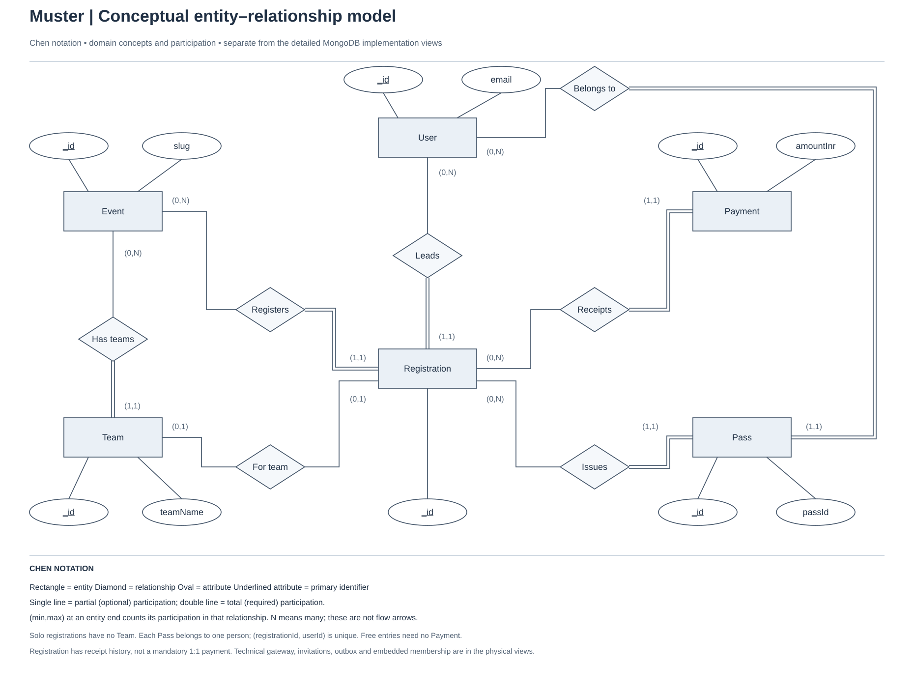
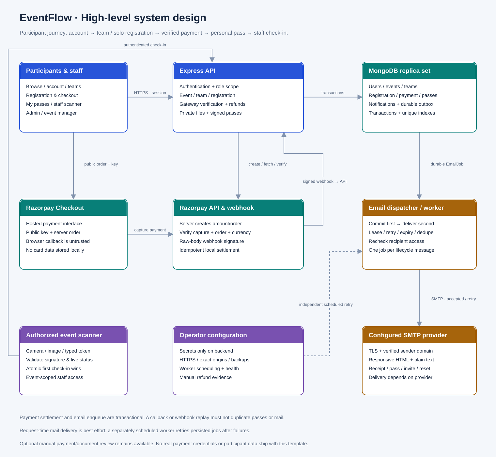

# Architecture diagrams

Muster is a reusable event-management backend. The React reference client is
optional. These views show the implemented application, rather than proposed
microservices or a required frontend.

| View | Read it | Raster export | Editable source |
| --- | --- | --- | --- |
| C4 system context | [SVG](system-context.svg) | [PNG](system-context.png) | [draw.io](system-context.drawio) |
| C4 container design | [SVG](system-design.svg) | [PNG](system-design.png) | [draw.io](system-design.drawio) |
| Conceptual ER, Chen notation | [SVG](conceptual-er.svg) | [PNG](conceptual-er.png) | [draw.io](conceptual-er.drawio) |
| Core data model, crow's-foot notation | [SVG](entity-relationship.svg) | [PNG](entity-relationship.png) | [draw.io](entity-relationship.drawio) |
| Team membership and notification data | [SVG](supporting-entities.svg) | [PNG](supporting-entities.png) | [draw.io](supporting-entities.drawio) |

## Reading the system views

The context diagram identifies people, the backend and external services. The
container diagram separates the Express API, MongoDB replica set and independent
email retry worker. A C4 container is a runnable application or data store, not
necessarily a Docker container. API modules remain inside one Express service.

Solid directed connectors represent requests; database connections represent
reads and writes. Dashed connectors distinguish webhook and email delivery.
Every view includes its own legend. The adopter's custom client is a possible
integration, while the reference web client is included in this repository.

## Reading the ER views

The conceptual diagram uses Chen rectangles for entities, diamonds for
relationships, ovals for attributes and underlined key attributes. Relationship
ends show minimum/maximum participation. Double lines indicate total
participation, and single lines indicate partial participation.

The implementation views use entity tables with distinct name and attribute
sections. `PK` identifies `_id`; `UQ` identifies an actual unique index; `FK`
marks a logical ObjectId reference. Crow's-foot endpoints express cardinality:
the circle means zero, the bar means one and the fork means many. Dashed lines
show non-identifying references; solid lines show embedded ownership.

MongoDB does not enforce SQL foreign-key constraints. Application checks and
indexes enforce the documented invariants. Embedded `Team.members[]` are
subdocuments, not a separate collection with an invented primary key. The
selected views deliberately omit some references to remain readable; the
[complete data model](../architecture/data-model.md) lists those references and
their indexes.





## Design and editing

Read the [high-level design](../architecture/high-level-design.md) for boundaries
and tradeoffs, and the [low-level design](../architecture/low-level-design.md)
for API contracts, sequence diagrams, states and failure handling.

Open the `.drawio` sources in diagrams.net to edit individual shapes and
connectors. SVG and PNG exports work without an account. Regenerate the editable
sources and SVGs using Python 3.10 or later:

```bash
python scripts/generate-diagrams.py
python scripts/check-architecture.py
```

The supplied PNGs are rendered exports. After modifying a source, export it from
diagrams.net or render its SVG with a local SVG-to-PNG tool, and visually check
the result. No diagram account or API key is required.

Notation follows the [C4 context](https://c4model.com/diagrams/system-context),
[container](https://c4model.com/diagrams/container) and
[notation](https://c4model.com/diagrams/notation) guidance, with conventional
[ER tables](https://www.drawio.com/docs/diagram-types/entity-relationship-tables/)
and [crow's-foot relationships](https://www.drawio.com/docs/tutorials/crows-foot-notation/).
