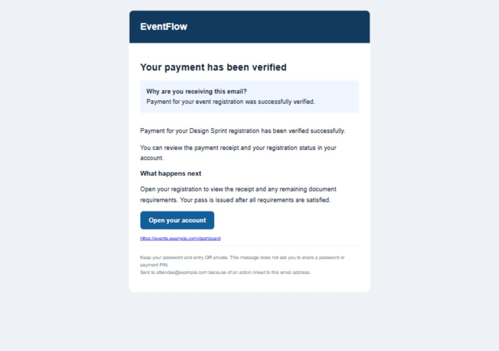

# Email previews

These previews use the same HTML/plain-text renderer as the backend. Every
address, link and event is fictional; no messages were sent. Open an HTML file
in a browser to inspect the shared email layout.

- [Account created](account_created.html)
- [Registration created](registration_created.html)
- [Payment verified](payment_verified.html)
- [Refund requested](refund_requested.html)

Run `node scripts/generate-email-previews.js` to regenerate them. Actual
production messages add current authorized registration details or individual
pass attachments where applicable. Those private details are deliberately
absent from these layout previews.

